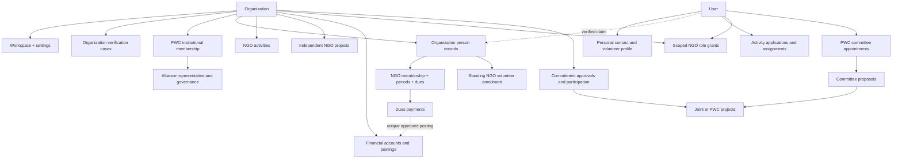

# Pakistan Welfare Club (PWC)
## Identity, Authorization & Multi-NGO Data Model Foundation v1.0 — Draft for Review

**Date:** 22 October 2026  
**Status:** WORKING DRAFT — NOT FORMALLY APPROVED  
**Initial scope:** Faisalabad launch, extensible to additional cities without presupposing a national/chapter constitution  
**Source hierarchy:** PWC Strategic & Product Foundation v1.0; PWC App Information Architecture & Navigation v1.0; PWC Detailed Mobile & Web Screen Specification v1.0; user-selected provisional decisions. The Coventure technical foundations are architectural reference only, not PWC policy.

> **Decision notation:** **[S]** user-selected, provisional; **[R]** architecture recommendation; **[O]** unresolved; **[D]** deferred. Implementation should not convert [R] or [O] into silently approved policy. References to legal obligations require evaluation under PWC's eventual legal registration and applicable law.

---

## 1. Architectural mission and non-negotiable boundaries

**[S]** PWC directly owns and operates the platform. It offers software workspaces to eligible organizations, including some which are not institutional alliance members. PWC is a hybrid welfare alliance and joint-project platform; individual member organizations retain their own leadership, activities, members, volunteers, finances, property and obligations. PWC is not the routine financial auditor of independent NGOs and does not assume liability solely from membership (subject to law and actual involvement).

**[R]** Model *three administrative jurisdictions* with explicit separation:

1. **Platform Operations:** identity authentication, infrastructure security, organization verification workflow, exceptional support and incident response.
2. **PWC Alliance Operations:** institutional membership, founding/elected Board, General Assembly, committees, alliance funds and PWC projects.
3. **Independent NGO Operations:** each organization's own member/volunteer roster, staff and roles, internal projects, private finance, documents, settings, reporting and retention decisions within applicable constraints.

Platform technical ownership does not create a standing business permission for Board members or other alliance actors to browse NGO-private data. Exceptional support access needs purpose, approval, limited duration, precise scope and immutable audit evidence. Technical superusers should not be reused as routine PWC business user accounts.

**Core invariants [R]:**
- One authenticated human maps to one `User` identity; simultaneous associations with multiple NGOs are separate grants.
- `Organization` exists independently of `PWCInstitutionalMembership`; a verified platform tenant is not necessarily an alliance member.
- `OrganizationMembership`, `OrganizationVolunteerEnrollment`, `OpportunityApplication`, `CommitteeMembership`, and `ProjectCommitment` are different relationships; none implies another.
- All NGO-private objects belong to an explicit `organization_id`; cross-tenant querying, writes, search, exports, documents and background jobs require tenant scoping.
- `PWC` governance roles do not inherit NGO tenant permissions. A professional title such as Treasurer or President is not a technical privilege.
- Publishing a project does not publish its budget, financial actuals, participants, documents or private comments.
- Every financial posting has a unique source/idempotency key; approved posting is atomic and auditable.
- PWC project approval does not bind any NGO until its own authorized approval policy is satisfied.

## 2. Context and tenant model

### 2.1 Principal entities

| Entity | Meaning | Boundary |
|---|---|---|
| `User` | Authenticated human, profile and verified contacts | Global personal identity |
| `Organization` | NGO, welfare society, or eligible group | Distinct legal/organizational subject |
| `OrganizationWorkspace` | Software tenant and configuration for an organization | Independent NGO operational jurisdiction |
| `PlatformVerificationCase` | Evidence and decision on eligibility and administrator authority | Technical/platform operations, separately permissioned |
| `PWCInstitutionalMembership` | Organization's membership in PWC alliance | Alliance jurisdiction; not a workspace license |
| `OrganizationMembership` | Human/member-record belonging to one NGO | NGO jurisdiction |
| `OrganizationVolunteerEnrollment` | Standing NGO volunteer relationship | NGO jurisdiction |
| `ActivityApplication` / `VolunteerAssignment` | Participation in a given activity | Organizer/activity scope |
| `Committee` / `CommitteeMembership` | PWC sectoral coordination and membership | PWC alliance scope |
| `Project` | Independent NGO, PWC-owned or joint initiative | Explicit owning scope |
| `ProjectParticipation` / `ProjectCommitment` | Organization involvement and authorized resource promises | Project + participating organization's approval scope |
| `FinancialAccount` / `FinancialEntry` | NGO-private recorded cash/bank and posting history | Strict NGO finance scope; separate PWC ledger |
| `RoleAssignment` | Scoped, time-bounded technical rights | Jurisdiction and resource-specific |

**[R]** Store PWC itself as a distinct institutional actor (`PlatformOperator` / `AllianceOrganization`) rather than pretending that all NGO tenant objects belong to a master NGO. If PWC runs its own NGO-like operating workspace, that tenant must still be distinct from other NGOs and from platform superuser access.

### 2.2 Context selection

Contexts: `PERSONAL`, `NGO(organization_id)`, `COMMITTEE(committee_id)`, `PROJECT(project_id)`, `PWC_ALLIANCE`, `PLATFORM_OPS`.

A client workspace switcher selects a display/interaction context; it **does not itself grant permissions**. Backend re-derives allowed actions from persisted, currently active assignments. Resource-specific checks always win over screen visibility. When a user loses a role, open screens, exports, deep links, background tasks, and cache entries must fail safely.

### 2.3 Tenant isolation strategy

**[R] MVP:** PostgreSQL shared database, tenant-owned rows with mandatory `organization_id` and scoped service/repository methods; organization-aware foreign keys/constraints where feasible. Use a tested tenant-query contract, ideally complemented by PostgreSQL Row-Level Security for high-risk finance/member tables if engineering and migration practices can support it safely. RLS is defense in depth, not a substitute for DRF-level authorization or support-operation policy.

**[R]** Every cross-tenant collaboration uses a *separate shared project/commitment record* rather than granting blanket access to an NGO's private records. Copy or project only approved fields, with provenance and expiration/revocation where appropriate. A partner organization must never receive foreign NGO tenant administrative roles by virtue of a collaboration.

**[O]** Database-per-tenant versus shared-database long-term scaling is not a user decision; the above is a proposed MVP implementation choice.

## 3. Identity and user lifecycle

### 3.1 User

Suggested fields: `id(UUID)`, `status`, `display_name`, `preferred_language`, `city`, `created_at`, `updated_at`, `last_login_at`; contact records stored separately with normalized values, verification timestamps and unique constraints as appropriate. `User` must not be mass-created from NGO imports. One user can have many memberships, volunteer relationships and role assignments.

**[R]** Authentication: verified email and/or phone (subject to delivery readiness), rate limiting, short-lived access credentials, revocable refresh sessions, device/session management, progressive multifactor authentication for financial approvers and platform administrators. Never use national identity document numbers as default public identifiers.

### 3.2 Distinguish imported people from active users

`OrganizationPersonRecord` represents an NGO-controlled record of a person, possibly without an app account. Membership/volunteer enrollment may reference this record; `linked_user_id` is optional until verified claiming. Records should include source, consent/notice metadata, duplicate-review status and attribution. Do not automatically merge duplicate-looking records between tenants.

**Claim workflow [S/R]:** NGO imports/creates record → authorized claim invitation or request → user verifies contact/identity → single-use expiring `ClaimToken` **or** recorded NGO administrator review → record linked to account → claims/audit log. Phone or name coincidence alone is insufficient. Claiming a volunteer record must not establish formal NGO membership.

### 3.3 Lifecycle states

- User: `active`, `limited`, `suspended`, `deactivated` (proposed).
- Organization workspace: `draft`, `provisional`, `verification_pending`, `verified`, `restricted`, `deactivated` (proposed).
- Verification case: `draft`, `submitted`, `needs_information`, `approved`, `rejected`, `disputed`.
- Imported record: `unclaimed`, `claim_pending`, `claimed`, `flagged_duplicate`, `archived`.

Status changes require actor, reason, time, state transition checks, and retention of previous state.

## 4. Organization creation, verification and administrative recovery

**[S]** A representative can create a limited provisional workspace. **[S]** Registered organizations and eligible unregistered welfare groups follow different evidence requirements. **[S]** PWC institutional membership is separate from platform access.

### 4.1 Entity proposal

`Organization(id, legal_name, display_name, category, registration_classification, registration_ref_nullable, sectors, locations, publication_status, ...)`;
`OrganizationWorkspace(organization_id, state, member_policy, volunteer_policy, default_visibility, ...)`;
`OrganizationClaim(id, organization_id, applicant_user_id, intent=create|claim, status, ...)`;
`VerificationCase(id, organization_id, representative_id, verification_track, status, evidence_refs, reviewer_id, decision_reason, ...)`.

Store *organization eligibility* and *representative authority* as separate verifications/decisions. Track document validity and re-verification triggers. Prevent active duplicate claims; support dispute and manual resolution paths.

### 4.2 Provisional privileges

Permitted: prepare organizational draft; upload verification evidence; edit own draft; track status. Prohibited until authorization/verification: import an existing NGO's roster, issue privileged staff grants, publish verified status, view existing tenant records, post finance, accept binding joint commitments, access PWC institutional votes. Minimum permissible pre-verification public content remains **[O]** and should default conservatively.

### 4.3 Admin changes and recovery

Recommend `OrganizationAuthorityChangeRequest` with evidence, expected current administrators, approval policy, requestor, approvers, expiry and immutable decision log. Losing access to the last primary admin uses reviewed recovery, **not** unilateral platform staff selection of new NGO governance. PWC platform support verifies authority, does not adjudicate substantive NGO leadership disputes beyond its service responsibilities.

## 5. Membership, fees and renewal domain

### 5.1 Distinct organizations and institutional memberships

`PWCInstitutionalMembership` links `Organization` → PWC and stores membership class, start/end, state, voting_eligible determination and nominated institutional representative. **[S]** Only eligible *registered full institutional members* vote in Board elections; volunteers/individual associates do not. **[S]** 24-month founding Board, then an 11-director Board elected by eligible organizations with authorized NGO nominees. Election procedures and legal organization are **[O]**.

### 5.2 Independent NGO members

| Model | Suggested key attributes / rule |
|---|---|
| `MembershipCategory` | `organization_id`, label, fee, duration/renewal method, fee_exempt_default, active |
| `MembershipPolicy` | organization, mode=`open|approval|invitation`, required fields, renewal/grace/reminder policy |
| `OrganizationMembership` | organization, person record, category, status, admission_date, membership_no, separate current renewal state |
| `MembershipApplication` | applicant or invitee, owning organization, state, reviewer, timestamp; protect duplicate concurrent admissions |
| `MembershipPeriod` | begin/end/due/grace dates, assessed amount, valid/expired state |
| `DuesAssessment` | source membership/period, assessed fee, posted adjustments, allocated paid amount |
| `DuesAdjustment` | waiver/discount/exemption reason, authorizer, amount, immutable history |
| `DuesPayment` | source assessment, amount, payment method, destination NGO account, confirmation state, posting reference |

**[S]** Configurable open, approval, invitation-only admission. **[S]** Category-based dues and renewal rules with discounts, exemptions, waivers and partial payments. **[S]** Configurable reminders/grace and automatic/manual expiry. **[S]** Manual fee collection recording; online processing deferred. Member status, renewal status and payment status are distinct.

**[R]** Validate nonnegative amounts, avoid over-allocation; surplus payment becomes explicitly tracked credit/refund subject to NGO policy; never silently force negative dues. Fee changes should not retroactively rewrite previously issued assessments. Role/designation grants remain independent of membership categories. Only organization-approved leaders and contacts may be public; general membership roster is private.

## 6. NGO volunteers, public participation and activities

Suggested: `VolunteerProfile(user_id, skills, interests, availability_visibility, city)`, `OrganizationVolunteerEnrollment(organization_id, person_record_id, state, enrollment_mode, screening_status)`, `VolunteerOpportunity(organizer_scope, project_id?, capacity, dates, skills, visibility, eligibility)`, `VolunteerApplication(opportunity_id, user_id, state)`, `VolunteerAssignment(opportunity_id, user_id, state, accepted_at)`, `ParticipationRecord(assignment_id, completion_confirmed_by, evidence_ref?, ...)`.

**[S]** NGO may choose open/approval/invitation-only *standing* volunteer enrollment. **[S]** Volunteer and member records may be imported by manual entry and CSV/Excel; unclaimed until securely linked. **[S]** Standing volunteering, formal NGO membership and one-off event participation are not interchangeable.

**[R]** A sensitive opportunity can enforce screening and organizer approval even if standing enrollment is open. Keep public view separate from volunteer roster/contact details, safeguarding checks and notes. A verification of service is evidence-based, not inferred simply from event registration.

**Activity/Event:** `Activity(id, owner_scope, owner_org_id?, visibility=public|members|private, organizer, schedule, place, state)`, `Registration`, `Attendance`, `Announcement`, scoped `Attachment`. Membership-only checks require membership with the owning NGO; private requires specific grant. Public listing must exclude restricted child/medical/person data.

## 7. Independent NGO project domain

**[S]** MVP includes projects, teams, tasks, milestones, required resources and basic budgets. **[S]** Eligible visibility `public`, `members_only`, `private`.

Recommended `Project` fields: UUID, kind=`independent_ngo|pwc_led|joint`, owner type+ID, name, sector, location, description, dates, state, visibility, organizer and lead IDs. For robust relational integrity, consider **separate owning FK columns with check constraints** or a `ProjectOwner` typed registry; avoid opaque arbitrary polymorphic IDs without checks.

Related: `ProjectTeamAssignment`, `ProjectTask`, `Milestone`, `ResourceRequirement`, `ProjectBudgetLine`, `ProjectUpdate`, `ProjectDocument`, `ProjectOutcome`. Each child inherits the parent's administrative scope and must be consistently authorized.

**[R]** Planned budget != posted expense. Actual cost is derived from eligible approved finance entries with explicit NGO-project links, only visible to authorized finance viewers; public project pages show authorized published aggregates, not private actuals. Closing projects must preserve records required by retention policy.

## 8. NGO-private finance and dues integration

### 8.1 MVP finance responsibilities

**[S]** Each NGO maintains *private* accounts and income/expense/donation records; PWC leadership has no general read or audit right. **[S]** More than one NGO cash/bank account, manual entry, account summaries and NGO-configurable `direct_entry|approval_required` processing. An NGO without multiple approvers may select direct entry. **[S]** Confirmed membership dues/donations create linked financial entries to the selected account, subject to approval mode.

Recommended models:

| Model | Boundary and constraints |
|---|---|
| `FinancialAccount` | organization; label; type=cash/bank; opening recorded amount; active flag |
| `FinancialSourceRecord` | dues/donation/manual income/manual expense; unique source reference, purpose and receipt metadata |
| `FinancialEntry` | organization; account; kind=inflow/outflow/transfer_leg/reversal; amount; state=draft/pending/posted/reversed; posted_at; source |
| `FinancialTransfer` | organization, from/to account, amount, paired entry IDs, transaction atomicity |
| `FinancialApproval` | submission, approver, decision, time, state transition; approver != submitter when required |
| `Donation` | organization, contributor privacy, donor contact permissions, restriction/purpose, recorded receipt |
| `FinancialCorrection` | source posted entry, correction/reversal entry, reason, actor, chain |
| `FinancePolicy` | organization, approval mode, grant/recovery method, effective date, policy version |

**[R] Financial invariants:**
1. Amounts represented in integer minor currency units or fixed-decimal (never binary floating point); currency stored explicitly.
2. `organization_id` and account ownership validated on *every* write; finance grants scoped specifically to that NGO.
3. A unique `(organization_id, source_kind, source_id, posting_kind)` guards one-time source posting; replay is idempotent.
4. Approval and posting use one transactional state transition with row locks and authoritative server recalculation.
5. Pending entries do not affect posted balance; linked dues payment confirmation UI accurately differentiates recorded/pending/posted.
6. Bank-to-cash transfer posts two opposite legs in one transaction; not treated as income/expense.
7. Posted entries immutable; adjustments/reversals produce new audit-linked entries.
8. Finance `view|create|submit|approve|export|manage_access` are separate permission atoms; primary NGO admin does not automatically have finance access.
9. Changing approval policy does not implicitly approve or reclassify existing entries.
10. Financial reporting does not claim bank reconciliation or statutory audit assurance.

### 8.2 NGO-selectable finance authority recovery

**[S]** Each NGO selects an approved access-grant method, with verified recovery. **[R]** Support organization-controlled single verified authority or multi-authorizer policy, preserving last-authority protections; grant/revocation and recovery are high-risk audited events. Avoid a self-service path where one person can escalate themselves without independent validation. Operators act under documented, logged recovery procedures, not PWC Board discretion.

### 8.3 Separate PWC accounts

PWC's *own* finance workspace should have separate ownership, ledgers and access policies. For a joint project, participating NGOs share agreed project commitment/reporting data; that is not a cross-NGO unified cash ledger. PWC project money actually received/controlled by PWC belongs to PWC's own accountable records.

## 9. Alliance governance, committees and institutional rights

Suggested `PWCInstitutionalMembership` plus `InstitutionalRepresentative`, `BoardTerm`, `BoardSeat`, `BoardAppointment`, `GeneralAssemblyMeeting`, `Resolution`, `Committee`, `CommitteeMembership`, `CommitteeMeeting`, `CommitteeProposal`, `PWCAnnouncement`.

**[S]** 11 voting Board seats; member-elected regular Board; 24-month founding period; only eligible registered full NGO members vote; individually enrolled associates/volunteers cannot vote. **[S]** Sectoral committees start progressively, with profiles, members, announcements, meetings and project proposals at MVP. **[D]** Formal electronic elections and complete national/chapter management.

**[R]** Board roles govern only PWC. `CommitteeConvener` can coordinate assigned sector but cannot command an NGO or accept its commitments. Institutional nominations require validated NGO authorization. Electoral eligibility should be snapshotted against the eventual constitutional rules; no implementation before governance articles are approved.

## 10. Collaboration and joint-project commitments

Recommended objects: `CollaborationRequest`, `CollaborationOffer`, `JointProjectInvitation`, `NGOCommitmentPolicy`, `CommitmentProposal`, `CommitmentApprovalStep`, `ProjectCommitment`, `CommitmentAmendment`, `ProjectParticipation`, `ProjectReportingContribution`.

**[S]** NGOs require explicitly authorized representatives; each may configure a **single-authorizer or multiple-internal-approver** commitment policy. **[R]** Capture organization, project, scope, resources, financial/volunteer obligations, proposed dates, proposer, approvers, policy version, approved snapshot, acceptance time and amendment history.

### Commitment state machine (recommended)

`invited -> interested -> proposed -> pending_internal_approval -> approved -> accepted -> active -> completed`, with alternate `declined`, `expired`, `withdrawn`, `amendment_pending`, and `cancelled` transitions subject to agreement. `interested` != `committed`; `PWC project approved` != `NGO commitment accepted`.

**[R]** An approving officer cannot approve beyond the scope of their NGO delegation. Changes to resource quantities/budgets/deliverables require a new approved version. A withdrawal might have contractual consequences; the UI must not imply guaranteed penalty-free exit.

## 11. Public inquiries, safeguarding, and sensitive data

**[S] MVP:** public citizens can discover, register, volunteer and submit general collaboration/assistance inquiries. **[S]** Formal beneficiary case management is Phase 2 only after safeguards.

**[R]** `PublicInquiry` stores category, submitted-by, limited description, safe contact channel, assigned restricted queue, triage status and minimal retention metadata. Warn users not to submit unnecessary medical or identity documents. Sensitive entries should be access-controlled and absent from general push-notification previews or global search.

Before Phase 2 cases: implement documented escalation, safeguarding response, consent/notice, retention and redirection procedure. Do not present simple inquiries as a fully managed or guaranteed welfare assistance service.

## 12. Authorization specification

### 12.1 Grants and denials

**[R]** `RoleDefinition(id, domain, name)`, `PermissionDefinition(code, domain, resource, action)`, `RolePermission(role_id, permission_id)`, `RoleAssignment(user_id, role_id, context_type, context_id, grantor, valid_from, valid_until, state)`, optional `ResourceGrant` for committee/project-specific operations. Deny by default; no implicit role inheritance across tenants/jurisdictions. Use explicit, versioned role bundles to prevent confusing platform upgrades from silently adding permissions.

**Recommended evaluation:** `authenticated?` → `is account active?` → `is scope active & verified?` → `resource belongs to scope?` → `is role assignment valid?` → `has permission atom?` → `does resource field/classification allow?` → `does state machine permit action?` → `audit sensitive action`.

### 12.2 Example scope matrix

| Actor | Own NGO roster | Own NGO finance | Another NGO | PWC committee | PWC Board | Platform ops |
|---|---|---|---|---|---|---|
| Ordinary NGO member | Limited own record / member content | No | No | Only separately appointed | No | No |
| NGO membership manager | Authorized | No | No | By assignment | No | No |
| NGO finance officer | Only if additionally granted | Finance-specific | No | By assignment | No | No |
| NGO primary administrator | Per explicit NGO scope | **No automatic finance grant** | No | By assignment | No | No |
| Committee convener | Only separate NGO role | Only separate finance role | No | Assigned committee | No implied Board role | No |
| PWC Board director | Only separate NGO role | Only separate NGO grant | No | If appointed | Defined governance powers | No |
| Platform support operator | Exceptional reviewed access only | Exceptional controlled access only | Exceptional reviewed access only | No ordinary policy power | No Board power | Approved technical tasks |

**[R]** Support roles such as `ngo.members.read|write|approve|export`, `ngo.volunteers.manage`, `ngo.activities.publish`, `ngo.projects.manage`, `ngo.finance.view|record|submit|approve|export`, `ngo.finance.grant`, `alliance.membership.review`, `alliance.committee.propose`, `project.commitment.approve`, `platform.organization.verify`, `platform.support.elevate`. Check subresources and file downloads independently.

### 12.3 Staff support break-glass

Exceptional access: verified incident/ticket ID, least privilege and scope, independent approval where possible, short TTL, explicit logging, notification/reporting as appropriate, and periodic reviews. Prefer metadata inspection and user-assisted support over direct data reading. Support access is not routine alliance governance access.

## 13. Proposed logical entity relationship map

This is conceptual; implementation should avoid using an unscoped polymorphic relation for security-sensitive foreign keys.

## 14. API and backend contract recommendations

**[R]** Suggested API prefixes (not final route names):
- `/api/v1/me/`, `/api/v1/identity/`, `/api/v1/organizations/` (public/claim), `/api/v1/ngo/{org_id}/...` (tenant scoped).
- `/api/v1/ngo/{org_id}/members/`, `/volunteers/`, `/activities/`, `/projects/`, `/finance/`, `/settings/`, `/exports/`.
- `/api/v1/alliance/memberships/`, `/committees/`, `/projects/`, `/governance/`.
- `/api/v1/projects/{project_id}/commitments/` with org-specific approval contexts; `/api/v1/platform/verification/`, `/support-access/`.

**Request rules:** explicit UUID identifiers; paginated lists; filter/search authorized at query time; command endpoints for transition-heavy changes; idempotency keys for payment posting and commitment acceptance; optimistic locking/version headers for mutable proposals; normalized error codes (`NOT_AUTHORIZED`, `WRONG_WORKSPACE`, `VERIFICATION_REQUIRED`, `STATE_CONFLICT`, `APPROVAL_REQUIRED`, `VALIDATION_ERROR`) without leaking private record presence.

**Django/DRF + PostgreSQL** and **Flutter mobile + a web admin framework** are **[R]** technology options aligned with earlier project foundations; not yet user-approved PWC implementation choices. Implement permission enforcement in backend domain services and queryset scoping, not only serializers and UI. Test every endpoint with wrong-tenant, revoked-role and direct-object-ID scenarios.

## 15. Security, privacy, audit and data lifecycle

**[S]** Authorized export, workspace deactivation, and policy-based retention/deletion on platform exit. **[R]** Separate alliance withdrawal (revokes alliance privileges) from software departure (export/deactivation/retention workflow). Deletion is not immediate where legal holds or legitimate retention requirements apply.

**[R]** Data classification: Public, NGO Members-only, NGO Internal, NGO Restricted Finance, PWC Alliance, PWC Joint Project, Highly Sensitive (beneficiary/safeguarding). Do not let public visibility override per-field confidentiality.

Requirements: encrypted transport, encrypted sensitive backups, secrets isolation, restore tests, audit for privilege and finance events, attachment-level authorization, export logs, administrative access reviews, incident and breach response procedures, minimal data capture, consent/notice handling for imported records, contact preferences, spam/rate controls, reasonable backup and disaster recovery targets **[O]**.

**Export:** authenticated NGO-authorized actor requests an export of permitted scope → step-up verification for sensitive exports → asynchronous protected artifact with short expiry → logged download → delete export artifact per policy. Do not include unrelated NGO or PWC data.

**Data portability:** model stable identifiers, normalized export schemas and historical evidence; be explicit that shared project records may have separate retention and disclosure conditions.

## 16. Required acceptance and negative-access tests

| Test ID | Test |
|---|---|
| AUTH-01 | NGO A administrator cannot read/update/download NGO B member, volunteer, project, finance or file objects, even by ID tampering. |
| AUTH-02 | PWC Board director cannot view NGO A private finance without an independent NGO finance grant. |
| AUTH-03 | NGO primary admin does not automatically receive finance read, export, approve or grant permission. |
| AUTH-04 | User with two NGO roles switching workspaces never leaks stale cached records or permissions. |
| AUTH-05 | Revoked committee, project or NGO role immediately blocks new API activity and export/deep-link retrieval. |
| ORG-01 | Provisional NGO claimant cannot import/see an already existing NGO's data before verified authority. |
| ORG-02 | Registered and eligible unregistered organization verification follow appropriate separate evidence tracks. |
| MEM-01 | Open/approval/invitation membership policies apply per NGO; organization category never grants hidden staff privilege. |
| MEM-02 | CSV member import creates no login accounts; claim needs verified identity + valid token/NGO approval. |
| VOL-01 | Imported volunteer can claim record without becoming NGO member. |
| VOL-02 | One-off activity participation creates no standing NGO volunteer relationship unless separately approved. |
| FIN-01 | Same confirmed dues payment processed twice creates only one linked account entry. |
| FIN-02 | Pending financial approval does not affect posted recorded balance. |
| FIN-03 | Internal transfer yields equal/opposite account legs and no new income/expense. |
| FIN-04 | A submitter cannot approve same entry under separate-approver policy. |
| FIN-05 | Changing NGO policy to direct entry does not silently approve previous pending entries. |
| FIN-06 | Finance export requires specific grant and preserves an audit event. |
| PROJ-01 | Public project detail does not disclose private budget actuals, roster, attachments or sensitive fields. |
| COL-01 | PWC project approval does not create participating-NGO commitment. |
| COL-02 | Multi-approver NGO commitment requires all configured approvals for the specific proposal version. |
| EXIT-01 | Leaving PWC alliance does not delete independently authorized NGO workspace. |
| EXIT-02 | NGO export/deactivation includes own authorized records only and enforces retention policy. |
| SUP-01 | Exceptional platform support access requires ticket, scope, expiry and audit; no routine Board visibility. |

## 17. Staged backend deliverables, aligned to screens

| Milestone | Backend foundations and flows | Screen references |
|---|---|---|
| **M1** Secure Institutional Foundation | User authentication, contacts, context grants, NGO claim/provisional/verification, workspace settings, NGO member policies, member roster/import/claim, PWC verification support, audit | ID-01..05; ORG-01..12; PWC-01; OPS-01 |
| **M2** NGO Operations | Volunteer imports/applications/assignments; NGO activities and projects with teams/tasks/milestones/resources/budgets; dues/periods; accounts/entries/transfers/approvals/reports; NGO export/deactivation baseline | ORG-13..25; FIN-01..09; PUB-06/09 |
| **M3** Public + Alliance | Public search, safe inquiries, institutional PWC membership, committee membership/meetings/proposals, collaboration requests/offers, scoped NGO commitments, joint project reporting and PWC operations | PUB-01..10; ALL-01..03; COM-01..04; COL-01..05; PWC-02..05; GOV-01 |
| **Post-MVP [D]** | Formal electronic election workflows, sensitive beneficiary cases, integrated donation payment processing, national/chapter hierarchy, advanced accounting/AI | GOV-02; CASE-01; PAY-01; NAT-01 |

The milestones describe one first-release MVP; do not silently discard user-selected P0 functions. Consider internal feature flags for safe progressive testing.

## 18. Explicit open decisions for formal review

1. **[O] Legal structure:** PWC registration, legal accountability, donation authority, public notice/privacy obligations, statutory retention, and whether unregistered groups may access specific regulated capabilities.
2. **[O] Authentication:** phone, email, both, provider and MFA escalation policies; account recovery and identity evidence retention.
3. **[O] Verification rubric:** precise accepted documents, re-verification frequency, disputed-control appeal and escalation ownership.
4. **[O] Tenant support access:** operational approver, independent review, audit retention and notice policies for technical access.
5. **[O] Identity duplication:** matching thresholds and cross-tenant privacy treatment; do not implement silent merges.
6. **[O] Membership dues:** credit carry-forward, overpayments, refunds and status changes during grace periods.
7. **[O] Financial account rules:** opening balances, account closure, cross-year reporting, receipt numbering, refund allocation, permitted negative balances and account currency scope.
8. **[O] NGO finance authority:** available single/multiple-authorization recovery templates, escalation and what happens when approvers are unreachable.
9. **[O] Project commitments:** exact signatory evidence, e-signature/legal enforceability requirements, amendments/withdrawal rules and liability language.
10. **[O] Data lifecycle:** retention per data class, deletion eligibility, legal holds, export format, backup purge and support SLA.
11. **[O] NGO membership governance:** Board term after founding, election articles, one-NGO-seat cap, quorum and rights of different membership classes.
12. **[O] Operational nonfunctionals:** security baselines, retention and restore targets, availability, scalability, Urdu localization and accessibility targets.
13. **[O] API & infrastructure:** precise deployment choice, tenancy method, independent auditing tooling, file storage, notifications and integrations.

## 19. Formal review checklist

- [ ] Product owner confirms source-aligned **[S]** requirements and corrects any interpretation mistakes.
- [ ] NGO representatives review independence, admin recovery, membership flexibility and data export provisions.
- [ ] Security reviewer validates tenant isolation threat model, sensitive finance handling and support-access process.
- [ ] Finance-domain reviewer validates posted-balance invariants, receipt lifecycle, approvals, transfers and correction design.
- [ ] Governance/legal adviser checks membership, founding Board, statutory obligations, safeguarding and fundraising permissions.
- [ ] Mobile/web designers map screens and field actions to these domain and authorization rules.
- [ ] Engineering produces physical schema, migrations, API contracts, authorization test matrix and implementation plan only after open blocking decisions are resolved.

---

## Appendix A — Source mapping and status

- **PWC Strategic & Product Foundation v1.0 Draft:** primary source of PWC policy and selected product behaviors.
- **PWC App Information Architecture & Navigation v1.0 Draft:** routes, workspaces, cross-context access and M1–M3 sequencing.
- **PWC Detailed Mobile & Web Screen Specification v1.0 Draft:** screen references `PUB`, `ID`, `ORG`, `FIN`, `ALL`, `COM`, `COL`, `PWC`, `GOV`, `OPS`, and deferred `CASE`/`PAY`/`NAT`.
- **Coventure Identity/Authorization and Django foundations:** possible architectural reference only; no Coventure-specific business objects, eligibility rules, roles or feature assumptions are carried into PWC as requirements.

**Approval state:** Draft for review, not a final physical PostgreSQL design, public API contract, legal opinion, or engineering authorization.
